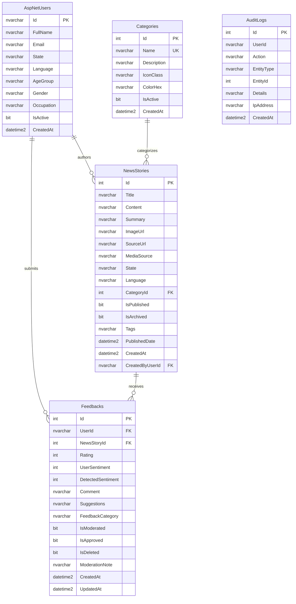

# SIH1329 — Database Schema & Architecture

**Database Engine:** Microsoft SQL Server 2022 (LocalDB / Express / Enterprise)  
**ORM:** Entity Framework Core 10.0  
**Database Name:** `GovernmentFeedbackDB`  

---

## 1. Entity Relationship Diagram (ERD)



---

## 2. Table Specifications

### A. `Categories`
Primary classification for policy sectors (Infrastructure, Healthcare, Education, Agriculture, Economy, Defence, Environment, Social Welfare, Technology, Foreign Policy).

| Column | Type | Constraints | Description |
|---|---|---|---|
| `Id` | INT | PRIMARY KEY, IDENTITY | Unique category identifier |
| `Name` | NVARCHAR(100) | NOT NULL, UNIQUE INDEX | Category title |
| `Description`| NVARCHAR(500) | NULL | Sector scope |
| `IconClass` | NVARCHAR(50) | NULL | FontAwesome icon identifier |
| `ColorHex` | NVARCHAR(20) | NULL | Hex color code for UI cards |
| `IsActive` | BIT | NOT NULL, DEFAULT 1 | Soft-disable switch |
| `CreatedAt` | DATETIME2 | NOT NULL, UTC | Timestamp |

### B. `NewsStories`
Aggregated and curated regional media news stories on government initiatives.

| Column | Type | Constraints | Description |
|---|---|---|---|
| `Id` | INT | PRIMARY KEY, IDENTITY | Unique story identifier |
| `Title` | NVARCHAR(500) | NOT NULL | News headline |
| `Content` | NVARCHAR(MAX) | NOT NULL | Full body text |
| `Summary` | NVARCHAR(1000) | NULL | Executive summary |
| `ImageUrl` | NVARCHAR(500) | NULL | Banner photograph |
| `SourceUrl` | NVARCHAR(500) | NULL | Original regional outlet URL |
| `MediaSource`| NVARCHAR(200) | NULL | Newspaper/Agency name |
| `State` | NVARCHAR(100) | NULL, INDEXED | Regional coverage State/UT |
| `Language` | NVARCHAR(50) | NULL | Media reporting language |
| `CategoryId` | INT | NOT NULL, FK (Categories), ON DELETE RESTRICT | Sector category |
| `IsPublished`| BIT | NOT NULL, INDEXED | Visibility to citizens |
| `IsArchived` | BIT | NOT NULL, DEFAULT 0 | Archive flag |
| `Tags` | NVARCHAR(500) | NULL | Comma-separated search tags |
| `PublishedDate` | DATETIME2 | NOT NULL, INDEXED | Date of publication |
| `CreatedAt` | DATETIME2 | NOT NULL, UTC | Record creation date |
| `CreatedByUserId` | NVARCHAR(450)| NULL, FK (AspNetUsers), ON DELETE SET NULL | Admin author |

### C. `Feedbacks`
Structured 360-degree citizen review submissions.

| Column | Type | Constraints | Description |
|---|---|---|---|
| `Id` | INT | PRIMARY KEY, IDENTITY | Unique feedback identifier |
| `UserId` | NVARCHAR(450) | NOT NULL, FK (AspNetUsers), ON DELETE CASCADE | Submitting citizen |
| `NewsStoryId` | INT | NOT NULL, FK (NewsStories), ON DELETE CASCADE | Target news story |
| `Rating` | INT | NOT NULL, CHECK (1 TO 5) | Numerical rating |
| `UserSentiment` | INT | NOT NULL | 1=Positive, 2=Neutral, 3=Negative |
| `DetectedSentiment` | INT | NULL | System-classified sentiment |
| `Comment` | NVARCHAR(2000)| NULL | Qualitative observation |
| `Suggestions` | NVARCHAR(2000)| NULL | Policy recommendation |
| `FeedbackCategory` | NVARCHAR(100)| NULL | Focus dimension |
| `IsModerated` | BIT | NOT NULL, DEFAULT 0 | Review status |
| `IsApproved` | BIT | NOT NULL, DEFAULT 1 | Public display flag |
| `IsDeleted` | BIT | NOT NULL, DEFAULT 0 | Soft-deletion flag |
| `ModerationNote` | NVARCHAR(500)| NULL | Administrator remark |
| `CreatedAt` | DATETIME2 | NOT NULL, UTC | Submission timestamp |
| `UpdatedAt` | DATETIME2 | NOT NULL, UTC | Last modification timestamp |

**Integrity Constraints:**
- `UNIQUE INDEX UX_Feedback_User_Story (UserId, NewsStoryId)` guarantees 1 submission per citizen per story.

---

## 3. SQL Views (Course Outcome CO5 Compliance)

### View: `vw_NewsFeedbackSummary`
Aggregates total submissions, average star rating, and positive/neutral/negative counts per news story:
```sql
CREATE VIEW vw_NewsFeedbackSummary AS
SELECT 
    n.Id AS NewsId,
    n.Title,
    c.Name AS CategoryName,
    n.State,
    n.Language,
    n.PublishedDate,
    COUNT(f.Id) AS TotalFeedbacks,
    ISNULL(ROUND(AVG(CAST(f.Rating AS FLOAT)), 2), 0) AS AverageRating,
    SUM(CASE WHEN f.UserSentiment = 1 OR f.DetectedSentiment = 1 THEN 1 ELSE 0 END) AS PositiveCount,
    SUM(CASE WHEN f.UserSentiment = 2 OR f.DetectedSentiment = 2 THEN 1 ELSE 0 END) AS NeutralCount,
    SUM(CASE WHEN f.UserSentiment = 3 OR f.DetectedSentiment = 3 THEN 1 ELSE 0 END) AS NegativeCount
FROM NewsStories n
LEFT JOIN Categories c ON n.CategoryId = c.Id
LEFT JOIN Feedbacks f ON n.Id = f.NewsStoryId AND f.IsDeleted = 0
WHERE n.IsPublished = 1
GROUP BY n.Id, n.Title, c.Name, n.State, n.Language, n.PublishedDate;
```

### View: `vw_RegionalFeedbackSummary`
Aggregates regional engagement across Indian States and Union Territories:
```sql
CREATE VIEW vw_RegionalFeedbackSummary AS
SELECT 
    ISNULL(n.State, 'National') AS State,
    COUNT(DISTINCT n.Id) AS NewsCount,
    COUNT(f.Id) AS FeedbackCount,
    ISNULL(ROUND(AVG(CAST(f.Rating AS FLOAT)), 2), 0) AS AverageRating
FROM NewsStories n
LEFT JOIN Feedbacks f ON n.Id = f.NewsStoryId AND f.IsDeleted = 0
WHERE n.IsPublished = 1
GROUP BY n.State;
```

---

## 4. Stored Procedures (Course Outcome CO5 Compliance)

### Procedure: `sp_GetDashboardKPIs`
Executes backend KPI summary calculations inside SQL Server:
```sql
CREATE PROCEDURE sp_GetDashboardKPIs
AS
BEGIN
    SET NOCOUNT ON;
    SELECT 
        (SELECT COUNT(*) FROM AspNetUsers) AS TotalUsers,
        (SELECT COUNT(*) FROM NewsStories WHERE IsPublished = 1) AS TotalNews,
        (SELECT COUNT(*) FROM Feedbacks WHERE IsDeleted = 0) AS TotalFeedbacks,
        (SELECT ISNULL(ROUND(AVG(CAST(Rating AS FLOAT)), 1), 0) FROM Feedbacks WHERE IsDeleted = 0) AS AverageRating,
        (SELECT COUNT(DISTINCT State) FROM NewsStories WHERE State IS NOT NULL AND IsPublished = 1) AS TotalStates,
        (SELECT COUNT(DISTINCT Language) FROM NewsStories WHERE Language IS NOT NULL AND IsPublished = 1) AS TotalLanguages;
END;
```

### Procedure: `sp_GetRegionalFeedbackAnalytics`
Filters and computes regional analytics with optional state filtering:
```sql
CREATE PROCEDURE sp_GetRegionalFeedbackAnalytics
    @State NVARCHAR(100) = NULL
AS
BEGIN
    SET NOCOUNT ON;
    SELECT 
        n.State,
        COUNT(DISTINCT n.Id) AS NewsCount,
        COUNT(f.Id) AS FeedbackCount,
        ISNULL(ROUND(AVG(CAST(f.Rating AS FLOAT)), 2), 0) AS AverageRating
    FROM NewsStories n
    LEFT JOIN Feedbacks f ON n.Id = f.NewsStoryId AND f.IsDeleted = 0
    WHERE n.IsPublished = 1
      AND (@State IS NULL OR n.State = @State)
      AND n.State IS NOT NULL
    GROUP BY n.State
    ORDER BY FeedbackCount DESC;
END;
```
